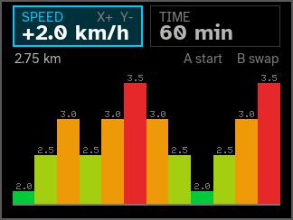
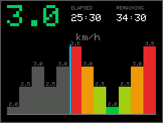
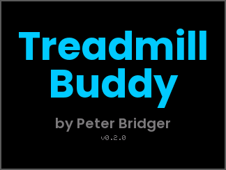
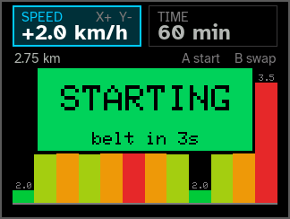
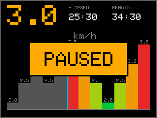
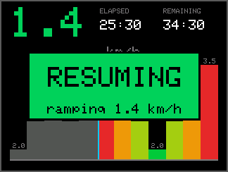
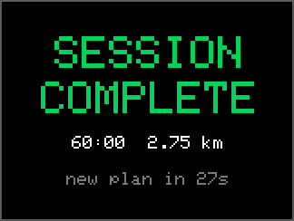
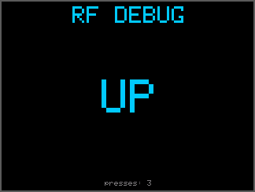

# Treadmill Buddy Native

Native C++ firmware for [Treadmill Buddy](https://github.com/MaverickUK/TreadmillBuddy): automated, varied-pace treadmill sessions on a Raspberry Pi Pico + Pimoroni **Pico Display Pack**, driving the treadmill's remote by replaying its RF codes through an **STX882** 433 MHz transmitter. It replaces the CircuitPython firmware, with the same screens, buttons and session plans.

 

## Status

Feature parity with the CircuitPython version 1.2.0, plus improvements. **Running on real hardware** (a Raspberry Pi Pico with the 2.8" Display Pack, since v0.1.0 on 2026-10-21). Still to confirm on hardware: driving the treadmill over RF and a full session. See [Hardware testing](#hardware-testing).

## What's better than the CircuitPython version

- **The screen never freezes.** In CircuitPython, pressing START blocked everything for the treadmill's 5 s countdown plus the ramp. Each speed change blocked for about 2 s (5 presses × ~0.4 s). Now the treadmill runs on its own core and the UI stays live. It shows the countdown ("belt in 3s"), the speed ticking up as the belt ramps, and you can press **X** to abort at any point.
- **A stop always wins.** The treadmill core re-reads what's wanted before every press, so STOP interrupts a ramp or the countdown straight away instead of queuing behind it.
- **Exact RF timing.** A PIO state machine replays the captured codes at 1 µs resolution, with no jitter, whatever the CPUs are doing.
- **Fast, flicker-free display.** Each frame is drawn into a framebuffer and sent by DMA at 62.5 MHz (~20 ms per frame, with no CPU time spent on it). A frame is only redrawn when something on screen changes.
- **Watchdog.** If either core hangs, the board resets, and **the next boot sends STOP** in case the belt was still running.
- **RF test mode built in.** Hold **B** at power-up; no need to swap `code.py` for `debug_rf.py`.
- Starts in well under a second.

## Architecture

| Core | Owns | Never does |
|---|---|---|
| **Core 1** | The treadmill: RF presses towards the belt target, START countdown, gaps between presses | Touch the display or buttons |
| **Core 0** | Buttons, session state machine, drawing, LCD DMA, serial console, watchdog | Block on the treadmill |

The cores share one small struct ([treadmill_link.h](src/treadmill_link.h)). Core 0 publishes a **target**: whether the belt should be running, at what speed, plus a generation number. Core 1 publishes what it believes the belt is doing, and the latest target it has reached. Core 1 compares its assumed belt state with the target and sends one remote press at a time until they match ([belt.h](src/belt.h)). The controller is still open loop: there's no feedback from the treadmill, as before.

| Module | Purpose | Pure C++ (host-tested) |
|---|---|---|
| `config.h` | **All** tunable values: timings, speeds, pins, display pack. Start here. | ✓ |
| `plan.*` | The speed plan: random walk, intensity boost, resize. Port of `plan.py`. | ✓ |
| `app.*` | The session state machine. Port of `code.py`. | ✓ |
| `belt.*` | Assumed belt state, and the next press needed to reach a target. | ✓ |
| `treadmill_link.h` | Lock-free data shared between the cores. | ✓ |
| `canvas.*`, `screens.*` | RGB565 drawing and every screen. Port of `ui.py`. | ✓ |
| `font.h`, `fonts/*.h` | Anti-aliased fonts (Poppins, Atkinson Hyperlegible), pre-rendered by `scripts/make_font.py`. | ✓ |
| `rf_codes.h` | Captured mark/space timings for each remote button. | ✓ |
| `treadmill.*` | Core 1's loop. | |
| `rf_tx.*` | The PIO OOK transmitter. | |
| `st7789.*` | LCD driver (SPI + DMA). | |
| `status_led.*` | Optional RGB status LED. | |
| `main.cpp` | Wiring it together, serial console, watchdog. | |

## Screens

These are rendered by the host tests from the firmware's own drawing code. To regenerate them: `TREADMILL_PREVIEW_DIR=docs/screens test/run_native_tests.sh && python3 test/ppm_to_png.py docs/screens`.

| Splash | Planning | Starting (new) |
|---|---|---|
|  |  |  |
| **Running** | **Speed change** | **Paused** |
|  |  |  |
| **Resuming (new)** | **Completed** | **RF test mode** |
|  |  |  |

The 1.14" pack gets the compact layout (`docs/screens/*_114.png`).

## Buttons

| Button | Position | Action |
|---|---|---|
| **A** | top-left | Planning→start, Running→pause, Paused→resume |
| **B** | bottom-left | Planning→swap between adjusting SPEED and TIME |
| **X** | top-right | Planning→increase; Starting/Running/Paused→stop |
| **Y** | bottom-right | Planning→decrease |

The planning screen opens with **SPEED** selected (the left-hand card, lit in blue); **B** swaps to **TIME** on the right. SPEED (the intensity) and TIME work exactly as in the CircuitPython version (see its README); the screen was redesigned to give the chart more room, with no title and the two fields as cards. Any button skips the Completed screen. **X** during STARTING cancels the start and keeps the plan. During RESUMING it ends the session, as stop from Paused does.

## Behaviour changes from CircuitPython

- **Session clock.** It still starts only once the belt has counted down and reached the first speed (and again after a resume). After that it keeps running while the belt ramps between segments, because the ramp no longer blocks and is part of the walk. Previously each ramp's ~2 s was left off the clock.
- **No duplicate STOP.** STOP is only sent if the belt is believed to be running. For example, stopping from a pause that already stopped the belt sends nothing.
- **Debounce.** A press must be stable for 20 ms (`DEBOUNCE_MS`). Before, a press fired on the first edge, with a 40 ms lockout.
- Speeds are whole tenths of a km/h (`25` = 2.5 km/h), and the segment interval is in seconds (`SPEED_CHANGE_INTERVAL_S = 300`; use `15` for quick bench tests).

## Settings

Edit [src/config.h](src/config.h) and rebuild. It holds the same settings as `settings.py`, with the same defaults and comments. `static_assert`s catch invalid combinations at compile time, e.g. enabling the RGB LED when it shares the RF pin.

The display pack is chosen by build environment instead of `DISPLAY_MODEL`:

| Pack | Environment | Resolution | RGB LED pins |
|---|---|---|---|
| 2.0" / 2.8" | `pico_28` (default) | 320x240 | GPIO 26/27/28 |
| 1.14" | `pico_114` | 240x135 | GPIO 6/7/8 |

## Fonts

Text comes in three styles:
- **Poppins** (Bold 56/32 px, SemiBold 20/14 px) for the splash's name and byline.
- **Atkinson Hyperlegible**, which the Braille Institute designed for legibility, for the planning screen's fields and info line (Bold 24/16 px, Regular 15 px).
- The classic 5x7 pixel font for small labels, where unscaled pixels are the sharpest option (bar speeds, the 1.14" info line). It's also used, scaled up, on the screens not yet converted.

The smooth fonts are anti-aliased with 16 levels and blended onto the screen. The glyphs are rendered on your computer into `src/fonts/*.h` and kept in flash, so the firmware needs no font engine. To add a size (needs Pillow):

```sh
python3 scripts/make_font.py fonts/Poppins-Bold.ttf 40 POPPINS_BOLD_40 > src/fonts/poppins_bold_40.h
```

Both are under the SIL Open Font License (`fonts/OFL-*.txt`).

## Wiring

This is unchanged from the CircuitPython version.
- **STX882 DATA:** GP27.
- **LCD (SPI0):** SCK GP18, MOSI GP19, CS GP17, DC GP16, backlight GP20.
- **Buttons:** A/B/X/Y on GP12–15.

## Build and flash

**Flash a board with the latest release** (needs the GitHub CLI, `gh`):

```sh
scripts/flash-latest.sh                  # 2.0"/2.8" Display Pack
scripts/flash-latest.sh --pack 114       # 1.14" Display Pack
scripts/flash-latest.sh v0.3.0           # a specific release
scripts/flash-latest.sh --uf2 .pio/build/pico_28/firmware.uf2   # your own build
```

If the board is already running Treadmill Buddy, the script reboots it into the bootloader over USB, so there's nothing to press. Otherwise (a new board, or one running CircuitPython) it asks you to hold **BOOTSEL** while plugging in. It flashes with picotool when it can find one, and checks the board comes back as TREADMILLBUDDY. Every USB step has a time limit, so it can't hang. Release UF2s are named `treadmillbuddy-display28-vX.Y.Z.uf2` and `...-display114-...`.

To build it yourself:

One-time setup: VS Code + the PlatformIO extension (or `pip install platformio`).

```sh
pio run                  # 2.0"/2.8" pack -> .pio/build/pico_28/firmware.uf2
pio run -e pico_114      # 1.14" pack
pio run -t upload        # build and flash
pio device monitor       # serial console, 115200
```

**First flash** (the Pico is running CircuitPython): hold **BOOTSEL** while plugging in. When the `RPI-RP2` drive appears, run `pio run -t upload` or drag `firmware.uf2` onto the drive. After that, uploads reset the board automatically, and the serial command `b` also does it. Your CIRCUITPY files are untouched; to go back, flash the CircuitPython UF2 again.

GitHub Actions builds both UF2s on every push and publishes a release for every `vX.Y.Z` tag (the tag must match `FIRMWARE_VERSION` in `src/version.h`).

## Serial console

```
h  help
s  status: state, session clock, belt target vs assumed belt, presses sent, frame/render times, heap
1  send START       (raw presses: the tracked belt speed doesn't change)
0  send STOP
+  send SPEED_UP
-  send SPEED_DOWN
r  reboot
b  reboot into the USB bootloader
```

## Unit tests (run on your computer)

```sh
test/run_native_tests.sh                       # ASan + UBSan
SANITIZE=thread test/run_native_tests.sh       # TSan, for the two-core link
```

They cover:
- **Parity with `plan.py`.** [test/gen_plan_fixtures.py](test/gen_plan_fixtures.py) runs the original Python and records its output: 32 boosted random walks across their full press range, every zig-zag length, and 80 random sequences of planning-screen presses including resizes and fresh plans. The C++ must match exactly. Regenerate with `python3 test/gen_plan_fixtures.py ../TreadmillBuddy > test/native/plan_fixtures.h`.
- **The belt reconciler.** Countdown, ramp, a stop interrupting the countdown, part-press rounding.
- **The core link.** Including a two-thread test where core 0 changes target 2000 times and core 1 must land on the last one.
- **Whole sessions** against a simulated treadmill: start, segments, speed-change alert, pause/resume, completion, cancel.
- **Buttons, the canvas, and every screen at both sizes**, plus the speed colours against `ui.py`.

## Hardware testing

These are the things the host tests can't prove. The hardware is a Raspberry Pi Pico (RP2040) with the Pico Display Pack 2.8", tested 2026-10-21 (v0.1.0 to v0.3.0).

**Confirmed working:**
- **Boot and display.** It boots straight to the splash and then the planning screen. The picture is the right way up (no `LCD_ROTATE_180` needed), with the colours and layout as in the previews above.
- **Buttons on the planning screen.** B swaps SPEED/TIME, and X/Y adjust them.
- **Display speed.** `s` on the serial console reports `frame=21520us` for a full 320x240 frame (SPI at 62.5 MHz by DMA), and about 9 ms to draw one.
- **Both cores.** The treadmill core's heartbeat keeps the watchdog fed (no resets), and nothing is transmitted until asked.
- **USB.** The board shows up as TREADMILLBUDDY. `scripts/flash-latest.sh` flashes both a release and a local build without a button press (repeated runs, 5–7 s each).

**Still to test:**
1. **RF.** Hold **B** at power-up and press A/B/X/Y with the treadmill nearby. Each press should register exactly once; adjust `RF_REPEATS` if not. A logic analyser on GP27 should show the same envelope as `rf_codes.h`.
2. **A full session** with `SPEED_CHANGE_INTERVAL_S = 15` and `SESSION_DURATION_MIN = 5`: check the countdown/ramp display, pause/resume, and that X stops the belt mid-ramp.
3. **The 1.14" Display Pack** (`pico_114`): only tested on the host so far.
